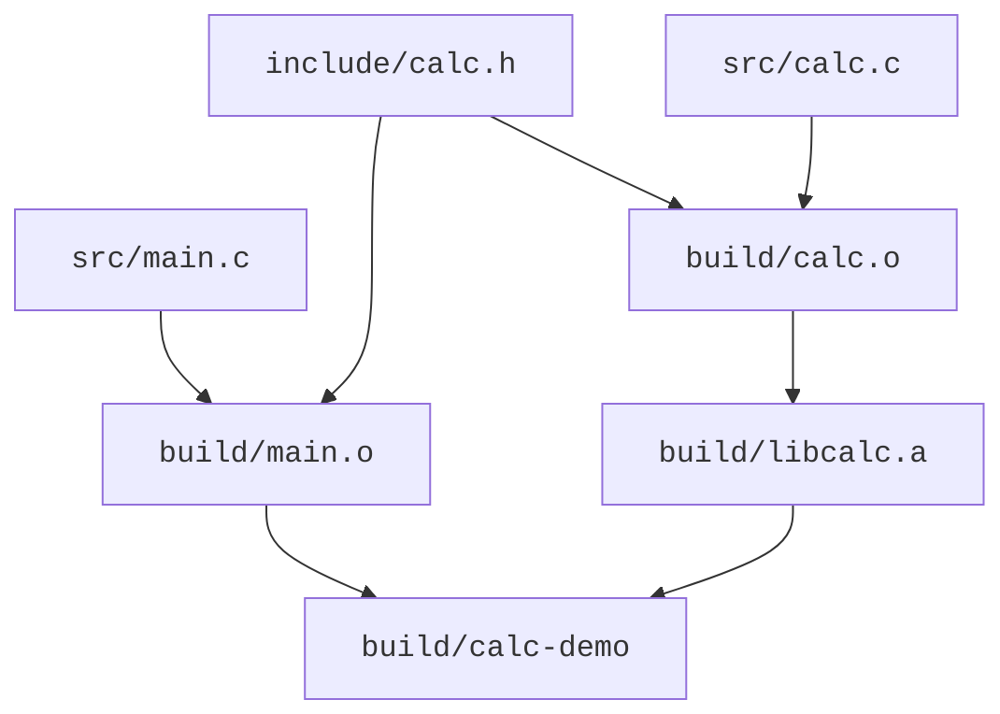

<script setup lang="ts">
import { sourceFiles } from "../_shared/example-files.ts"
</script>

# 多文件构建

上一节我们始终以单文件的编译为例。一个工程项目中，往往有多组源文件和头文件。本节就来探讨一下这又引入了什么复杂性。

## 接口与实现分离

在一个新的空目录中创建以下文件树及内容：

<CodeTree title="calc-demo" :files="sourceFiles" initial-file="src/main.c">
<template #header>

<<< ../_shared/assets/calc-demo/include/calc.h{c}

</template>
<template #calc>

<<< ../_shared/assets/calc-demo/src/calc.c{c}

</template>
<template #main>

<<< ../_shared/assets/calc-demo/src/main.c{c}

</template>
</CodeTree>

- `include/calc.h` 提供公开声明。头文件保护宏使它在同一个翻译单元中被重复包含时，声明区只展开一次。
- `src/calc.c` 定义函数，并负责库内部的日志开关。
- `src/main.c` 通过声明使用计算模块。

一个源文件连同它包含的头文件等内容，经过预处理后形成一个**翻译单元（translation unit）**。本例有两个翻译单元：`main.c` 和 `calc.c` 分别经过预处理得到的整体。它们包含同一个头文件，但仍各自编译，局部宏状态也各自独立。

包含 `calc.h` 让编译器知道 `calc_add` 的名字、参数和返回类型。`calc_add` 的函数体来自 `calc.c`，需要将它生成的目标文件参与链接。编译器不会根据头文件名自动找到并编译同名 `.c`。

## 头文件搜索路径

执行以下命令，观察其报错：

```sh
mkdir build
gcc -std=c17 -c src/main.c -o build/main.o
```

请自行学习完成以下内容：

1. 确定报错发生在哪一阶段（预处理、编译、汇编或链接）。
2. 学习 `-I` 选项。如何修改编译命令，使它正确工作。
3. 不改编译命令，不改代码，尝试通过更改目录结构或文件位置，让编译正确工作。
4. 不改编译命令，不移动文件，尝试通过修改代码中的 `#include` 语句，让编译正确工作。
5. `#include` 语句中使用尖括号 `<...>` 与双引号 `"..."` 的区别是什么？在本例中，哪种方式更合适？

回到原来的代码，使用 `-I` 选项指定头文件搜索路径的方式，分别编译两个源文件，获得两个目标文件 `build/main.o` 和 `build/calc.o`，然后继续完成后面的学习。

## 链接多个目标文件

运行：

```sh
gcc build/main.o -o build/main
```

学习完成：

1. 这次的报错发生在哪一阶段？
2. 怎么修改命令，使其正确工作？
3. 合并上一小节的命令，用一条命令一次性编译两个源文件并链接成可执行程序。

## 归档：把目标文件组织成静态库

**归档（archive）**将一个或多个文件组织进一个文件。在本章的 GNU 工具链中，静态库通常是目标文件的归档，以 `.a` 为后缀，其中的每个目标文件称为一个**成员（member）**。这样可以把一组已编译的实现作为一个库管理和复用。

本例用 `ar` 将 `build/calc.o` 放入静态库 `build/libcalc.a`：

```sh
ar rcs build/libcalc.a build/calc.o
```

`rcs` 中，`r` 插入文件或替换同名成员，`c` 抑制首次创建归档时的提示，`s` 建立或更新供链接器查找符号的索引。如果再次执行该命令，则会用新的 `build/calc.o` 更新库中的同名成员。选项的具体规则可查 [GNU ar 命令行文档](https://sourceware.org/binutils/docs/binutils/ar-cmdline.html)。

`ar t` 列出归档成员：

```sh
ar t build/libcalc.a
```

```
calc.o
```

归档得到的 `.a` 仍是链接输入。将调用者的目标文件与静态库一起链接，才能得到本例的可执行程序：

```sh
gcc build/main.o build/libcalc.a -o build/calc-demo
./build/calc-demo
```

应输出 `2 + 3 = 5`，与直接链接两个 `.o` 的结果相同。

也可以通过库搜索目录和库名来指定它：

```sh
gcc build/main.o -Lbuild -lcalc -o build/calc-demo
./build/calc-demo
```

- `-Lbuild` 将 `build/` 加入链接时的库搜索路径。
- `-lcalc` 按库名 `calc` 查找库；对应静态库文件名 `libcalc.a`，参数省略 `lib` 前缀和 `.a` 后缀。

本例 `build/` 中只有 `libcalc.a`，因此两种写法使用同一个库，运行结果相同。在 Linux 上，`-l` 也支持共享库（`.so` 文件）；若同一搜索目录中同时存在 `libcalc.so` 和 `libcalc.a`，GNU 链接器默认优先选择 `.so`。

在本例的 GNU 链接环境中，需要把使用库的 `main.o` 放在静态库或 `-lcalc` 前面。库的查找和输入顺序会影响链接，详见 [GCC 链接选项文档](https://gcc.gnu.org/onlinedocs/gcc/Link-Options.html)。

修改 `src/calc.c` 后，需要依次重新编译 `calc.o`、更新 `libcalc.a`、重新链接程序，新的实现才会进入可执行程序。

## 静态库与共享库

- **静态库（static library）**：链接器将程序需要的目标代码并入可执行程序。运行程序时，无需再加载这份静态库文件。
- **共享库（shared library）**：实现保留在独立文件中，由加载器在程序启动时或运行过程中加载。运行时需要能找到与程序兼容的库。

共享库也叫**动态库**或**动态链接库**，Windows 常称其为 **DLL（Dynamic-Link Library）**。

各平台和工具组合的常见文件名如下：

| 平台／工具组合     | 静态库      | 共享库／动态链接库          |
| ------------------ | ----------- | --------------------------- |
| Linux              | `libcalc.a` | `libcalc.so`                |
| macOS              | `libcalc.a` | `libcalc.dylib`             |
| Windows／MSVC      | `calc.lib`  | `calc.dll`                  |
| Windows／MinGW-w64 | `libcalc.a` | `calc.dll` 或 `libcalc.dll` |

Windows 使用 DLL 时，链接阶段常配合一份**导入库（import library）**，提供链接到 DLL 所需的信息，实际函数实现位于 DLL 中。MSVC 的导入库通常也叫 `calc.lib`，MinGW-w64 常用 `libcalc.dll.a`；运行时仍需对应的 DLL。因此，`.lib` 既可能是静态库，也可能是导入库。

## 增量构建

比较前面三种构建方案，[构建系统](../build-systems/intro.md)节点中的 Makefile 和 CMake 示例采用第三种：

1. 一条命令一次性编译两个源文件并链接成可执行程序。
2. 分别编译两个源文件，得到两个目标文件，再直接链接成可执行程序。
3. 分别编译两个源文件，将 `calc.o` 归档为 `libcalc.a`，再用 `main.o` 和静态库链接成可执行程序。

分析对比这三种方案：

1. 只修改 `src/calc.c` 后，三种方案分别需要执行哪些步骤？哪些已有产物可以沿用？
2. 修改公共头文件 `include/calc.h` 后，哪些目标文件需要重新编译？静态库方案还需要更新哪些产物？
3. 想通过 `-DCALC_TRACE=1` 让 `calc_add` 输出日志，这个选项必须用于哪个源文件的编译？分别编译时，能否沿用未改变编译输入的 `main.o`？采用静态库时，还需要执行哪些步骤？

<br>

**增量构建**根据已有产物和输入变化，只执行需要更新的构建步骤。

如何判断哪些文件需要重新编译？我们可以进行依赖分析。下图展示静态库方案的文件依赖，箭头从输入指向依赖它的产物：



`calc.o` 更新后，还要更新 `libcalc.a`，再重新链接程序。直接链接两个 `.o` 的方案则省去归档步骤。

头文件也是编译输入。可以让 gcc 列出用户头文件依赖：

```sh
gcc -MM -Iinclude src/main.c
```

应得到类似 `main.o: src/main.c include/calc.h` 的依赖列表。

更大的工程还有间接包含的头文件，因此只比较 `.c` 的时间戳会漏掉变化。此外，宏定义、编译选项和工具链变化都可能使旧产物失效。依赖分析正确还不够，构建系统需要有相应的更新机制。

完成本页实验后，恢复文件树中的源码，按默认日志开关 `CALC_TRACE=0` 重新编译两个 `.o`、更新静态库并链接。运行 `build/calc-demo`，应只打印 `2 + 3 = 5`。

## 思考

1. 示例的 `src/main.c` 中有 `#include <stdio.h>`。为什么不需要指定 `-I` 选项就能找到头文件 `stdio.h`？
2. 头文件 `stdio.h` 提供声明后，`printf` 的定义由谁提供？为什么不需要把它的实现源码 `xxx.c` 或 `xxx.o` 加入编译命令？
3. 为什么需要 `calc.h`？删掉头文件，直接在 `main.c` 中声明 `#include "clac.c"` 怎么样？
