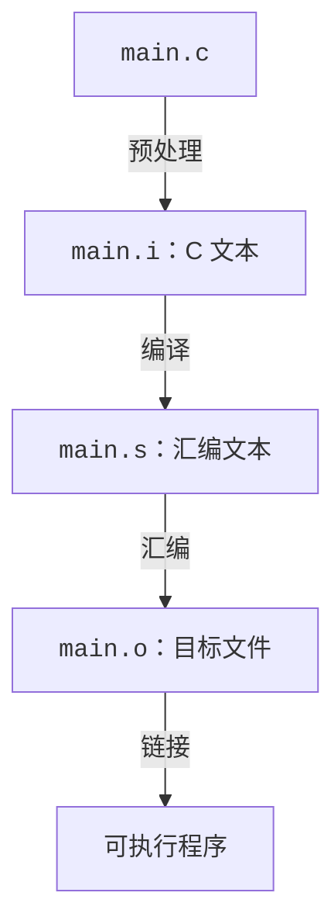

# 编译指令和构建流程

## 从一条编译命令开始

进入一个空目录，新建 `main.c` 写入以下代码：

<<< ./assets/single-file/main.c{c}

使用 gcc 编译 `main.c`：

```sh
gcc -std=c17 main.c -o main
```

`-std=c17` 选择 C17 标准，`-o main` 指定输出文件名为 `main`。编译器会自动选择预处理、编译、汇编和链接四个阶段，生成可执行程序 `main`。

运行 `main`：

```sh
./main
```

预期输出：

```
2 + 3 = 5
```

改用 Clang 的对应命令则为：

```sh
clang -std=c17 main.c -o main
./main
```

它应产生相同的程序输出，但生成的机器代码和诊断文本可能不同。

## 宏定义、警告与优化

### `-D`：向预处理阶段传入宏

源码用 `#ifndef` 为 `CALC_TRACE` 提供默认值 `0`。命令行定义同名宏后，这个默认定义就会被跳过：

```sh
gcc -std=c17 -DCALC_TRACE=1 main.c -o main
./main
```

预期输出：

```
[calc] add(2, 3)
2 + 3 = 5
```

`-DNAME=value` 提供宏的替换内容；`-DNAME` 等价于定义为 `1`。它影响本次命令中要预处理的源文件。

### `-W...`：请求诊断

`-Wall` 开启一组常用警告，`-Wextra` 补充其他警告，`-Wpedantic` 根据所选标准报告部分不符合标准的用法。`-Wall` 的名字不表示启用了所有警告；无警告也不能证明程序正确。

保存一个故意有未使用变量的 `unused.c`：

```c
int main(void)
{
    int unused = 3;
    return 0;
}
```

对同一份源码依次执行三组命令。每次编译后立即用 `echo $?` 查看上一条命令的退出状态：`0` 表示成功，非零表示失败。

```sh
gcc -std=c17 unused.c          # 注意没有提供 -o 会发生什么？
echo $?

gcc -std=c17 -Wall unused.c
echo $?

gcc -std=c17 -Wall -Werror unused.c
echo $?
```

在 GCC 13.3.0 下，结果如下；具体诊断文字可能随版本变化：

| 额外选项        | 诊断               | 退出状态 | 本次是否生成程序 |
| --------------- | ------------------ | -------- | ---------------- |
| 无              | 本例无诊断         | `0`      | 是               |
| `-Wall`         | 未使用变量的警告   | `0`      | 是               |
| `-Wall -Werror` | 同一问题被视为错误 | 非零     | 否               |

后两组的诊断分别类似：

```
warning: unused variable 'unused' [-Wunused-variable]
error: unused variable 'unused' [-Werror=unused-variable]
```

第一组没有额外开启警告，不代表 GCC 关闭了所有诊断；只是本例的问题没有被默认报告。`-Wall` 使它被报告为警告，编译仍能成功。

`-Werror` 将产生的警告视为错误，可用于让自动构建在出现警告时失败。

### `-O...`：选择优化等级

优化会改变生成代码、编译耗时和调试时的观察结果。`-O0` 适合先观察源代码与汇编的大致关系；`-O2` 开启更多优化，可能内联函数、折叠常量或消除无用代码。

将以下代码保存为 `sum.c`：

```c
#include <stdio.h>

int main(void) {
    int sum = 0;
    for (int i = 0; i <= (int)5e8; i++)
        sum += 2;
    printf("%d\n", sum);
    return 0;
}
```

用不同的优化等级编译并对比运行速度：

```sh
gcc -std=c17 -O0 sum.c -o sum-o0
gcc -std=c17 -O2 sum.c -o sum-o2

# 分别运行，对比差异
./sum-o0
./sum-o2
```

在这个案例的 O2 优化下，gcc 会在编译阶段直接计算出循环的结果，生成的程序不需要执行循环就能输出结果，因此运行速度会快得多。

各等级具体控制什么，可查 [GCC 优化选项](https://gcc.gnu.org/onlinedocs/gcc/Optimize-Options.html)。

## 四个阶段及产物

C/C++ 的构建通常可以分为四个阶段：预处理、编译、汇编和链接。



这里“编译”专指将预处理后的 C 程序转换为汇编文本的阶段；但日常口语中的“编译项目”也常常指整段构建过程。

### 1. 预处理：得到 `.i`

`-E` 选项让 gcc 停在预处理阶段之后。

```sh
gcc -std=c17 -DCALC_TRACE=0 -E main.c -o main.i
```

预处理处理 `#include`、宏替换和条件编译等指令。`stdio.h` 的内容会出现在结果中，因此 `.i` 往往比源码长得多。

将宏定义改为 `-DCALC_TRACE=1`，生成的 `.i` 文件有什么不同？

### 2. 编译：得到 `.s`

`-S` 选项让 gcc 停在编译阶段之后，输出汇编（assembly）文本。

```sh
gcc -std=c17 -S main.i -o main.s

# 也可以直接从源码编译得到汇编文本：
gcc -std=c17 -S main.c -o main.s
```

编译器进行语法、类型等检查并生成代码，本例的输出是可以阅读的汇编文本。x86-64 Linux 上可能看到类似节选：

```asm
    .globl calc_add
calc_add:
    # 省略函数入口和取参数的指令
    addl %edx, %eax
    # 省略函数退出前的指令
    ret
```

这一段是 `calc_add` 函数的汇编实现。

我们也可以从生成的汇编代码来对比一下优化的效果：

```sh
gcc -std=c17 -O0 -S main.c -o main-o0.s
gcc -std=c17 -O2 -S main.c -o main-o2.s

# 用一个文本编辑器打开对比生成的两个汇编文件；或者也可以用 diff 命令：
diff -u main-o0.s main-o2.s
```

可以发现 O2 优化后的 `main` 函数中不再有对 `calc_add` 的调用了，编译器直接将 `2 + 3` 的结果计算出来了。

此时如果细心观察可能会发现，O2 优化后虽然没有对 `calc_add` 的调用了，但汇编代码里却还保留着它的实现。那么为什么编译器不直接彻底删掉这个函数呢？不要着急。当学完本节剩余的内容后，你就能解答这个问题了。

### 3. 汇编：得到 `.o`

`-c` 选项让 gcc 停在汇编阶段之后，输出二进制目标文件（object file）。

```sh
gcc -c main.s -o main.o

# 也可以直接从源码编译得到目标文件：
gcc -std=c17 -c main.c -o main.o
```

`.o` 是二进制目标文件，没法再用普通的文本方式阅读。它包含机器代码、数据、符号和重定位信息等，可以用以下工具查看：

```sh
objdump -dr main.o
nm main.o
```

`objdump -dr` 把机器代码反汇编并显示重定位信息。可以看到输出的反汇编结果和之前的 `.s` 文件内容类似。

`nm` 列出符号和地址，结果类似于：

```
0000000000000000 T calc_add
0000000000000018 T main
                 U printf
```

`T` 表示本目标文件的代码区定义了该符号，前面的数字则是其地址；`U` 表示该符号还需要外部定义。

`printf` 的实现由 C 标准库提供，而不在 `main.o` 中。要生成可执行程序，还需要链接相应的 C 库以满足这一引用。

### 4. 链接：得到可执行程序

```sh
gcc main.o -o main
./main
```

`gcc` 驱动链接器，将目标文件与所需的启动支持和库组合起来，处理符号引用及地址安排。这里通过默认的 C 库链接满足 `printf` 等引用。

不过，链接完成并不表示所有库实现都已复制进可执行文件。采用动态链接时，运行时加载器会根据程序记录的依赖，查找并加载所需的共享库，使程序能够使用其中的实现。静态库与共享库的区别将在下一节介绍。
