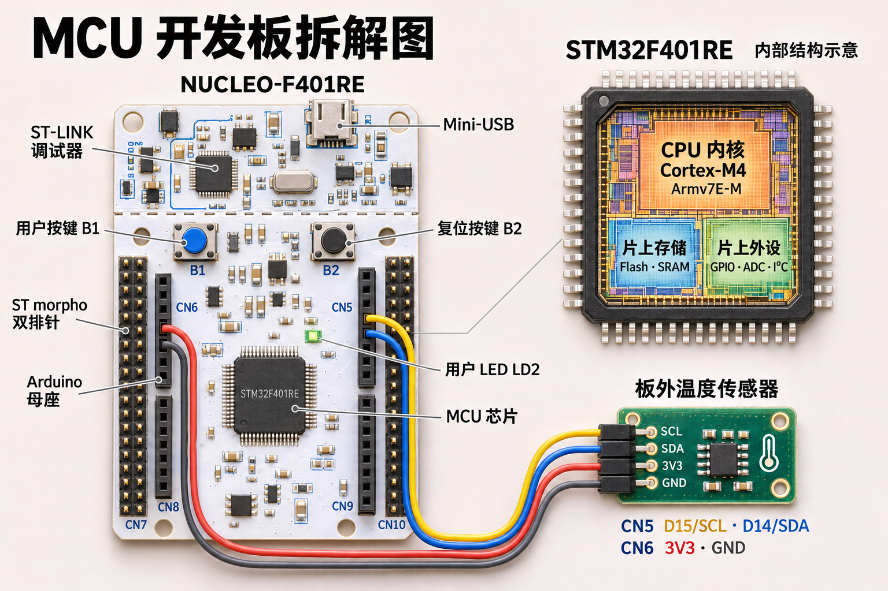

# C 语言嵌入式基础

一块开发板最核心的结构层级是怎样的？

以 ST 的 NUCLEO-F401RE 开发板为例，它的关键层级可见下图：

开发板上有众多设备，其中最核心的便是 MCU，也称单片机。NUCLEO-F401RE 开发板上使用的 MCU 是 STM32F401RE，它是 ST 公司生产的一款 32 位 ARM Cortex-M4 内核的微控制器。Cortex-M4 是 Arm 公司设计的处理器内核，它实现了 Armv7E-M 架构规范。

STM32 是 ST 公司的 MCU 产品家族，采用 Cortex-M 内核。它包含多个定位不同的系列：

- [STM32F1 系列](https://www.st.com/en/microcontrollers-microprocessors/stm32f1-series.html)：Cortex-M3 内核，面向通用控制，适用于基础控制和接口通信。
- [STM32F4 系列](https://www.st.com/en/microcontrollers-microprocessors/stm32f4-series.html)：Cortex-M4 内核，支持浮点运算和数字信号处理，适用于实时控制和信号处理。
- [STM32G0 系列](https://www.st.com/en/microcontrollers-microprocessors/stm32g0-series.html)：Cortex-M0+ 内核，注重成本与集成度，适用于家电、消费电子等通用控制。
- [STM32G4 系列](https://www.st.com/en/microcontrollers-microprocessors/stm32g4-series.html)：Cortex-M4 内核，侧重模拟外设与实时控制，适用于电机控制和数字电源。
- [STM32H7 系列](https://www.st.com/en/microcontrollers-microprocessors/stm32h7-series.html)：Cortex-M7 内核，部分型号还集成 Cortex-M4 内核，适用于计算量和资源需求较大的应用。
- [STM32L4 系列](https://www.st.com/en/microcontrollers-microprocessors/stm32l4-series.html)：Cortex-M4 内核，侧重低功耗，适用于电池供电的传感器和便携设备。

同一系列内，不同型号提供不同规格的存储容量、外设和引脚配置。

---

下面的视频介绍了 STM32 系列 MCU 的一些背景和基本概念：

- [Bilibili - 初识 STM32](https://www.bilibili.com/video/BV1Vt411X7PK/?p=3)
