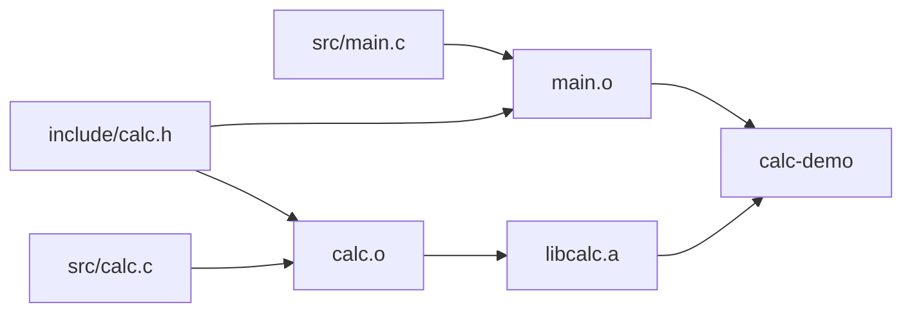

<script setup lang="ts">
import { sourceFiles } from "./example-files.ts"
</script>

# 多文件、静态库与增量构建

每个 `.c` 文件可以分别编译成目标文件，再通过链接组成程序。头文件提供共享声明，静态库组织目标文件，构建依赖则决定修改后需要重做哪些工作。

## 把接口与实现拆开

如果接着上一节操作，先用 `cd ..` 返回 `single-file/` 的父目录。然后新建并进入多文件工程目录：

```sh
mkdir -p calc-demo/src calc-demo/include
cd calc-demo
```

按文件树中的路径创建文件，点击文件名查看并复制完整代码：

<CodeTree title="calc-demo" :files="sourceFiles" initial-file="src/main.c">
<template #header>

<<< ./assets/calc-demo/include/calc.h{c}

</template>
<template #calc>

<<< ./assets/calc-demo/src/calc.c{c}

</template>
<template #main>

<<< ./assets/calc-demo/src/main.c{c}

</template>
</CodeTree>

- `include/calc.h` 提供公开声明。头文件保护宏使它在同一个翻译单元中被重复包含时，声明区只展开一次。
- `src/calc.c` 定义函数，并负责库内部的日志开关。
- `src/main.c` 通过声明使用计算模块。

一个源文件连同它包含的头文件等内容，经过预处理后形成一个**翻译单元（translation unit）**。本例有两个翻译单元：`main.c` 和 `calc.c` 分别经过预处理得到的整体。它们包含同一个头文件，但仍各自编译，局部宏状态也各自独立。

包含 `calc.h` 让编译器知道 `calc_add` 的名字、参数和返回类型。`calc_add` 的函数体来自 `calc.c`，需要将它生成的目标文件参与链接。编译器不会根据头文件名自动找到并编译同名 `.c`。

## 头文件搜索路径

先故意漏掉头文件目录：

```sh
mkdir -p build
gcc -std=c17 -c src/main.c -o build/missing-header.o
```

应出现找不到 `calc.h` 的错误。对于本例的 `#include "calc.h"`，GCC 先搜索包含这条指令的文件所在目录，即 `src/`；头文件实际在 `include/`，因此需要添加搜索目录：

```sh
gcc -std=c17 -Wall -Wextra -Wpedantic -O0 -Iinclude -c src/main.c -o build/main.o
gcc -std=c17 -Wall -Wextra -Wpedantic -O0 -Iinclude -c src/calc.c -o build/calc.o
gcc build/main.o build/calc.o -o build/calc-direct
./build/calc-direct
```

应打印 `2 + 3 = 5`。`-Iinclude` 中的相对路径以命令的工作目录为起点；它提供目录，编译器再在其中寻找 `calc.h`。

引号形式会先搜索包含者所在目录，再继续按配置的路径搜索；尖括号形式跳过这一步。`-I` 添加的目录对两种形式都可起作用，系统头文件还有工具链配置的搜索目录。[GCC 头文件搜索文档](https://gcc.gnu.org/onlinedocs/cpp/Search-Path.html)给出了具体顺序。

区分三种用途不同的路径：

| 设置            | 谁使用它   | 查找什么                |
| --------------- | ---------- | ----------------------- |
| Shell 的 `PATH` | Shell      | `gcc` 等命令入口        |
| `-I目录`        | 预处理阶段 | `#include` 指定的头文件 |
| `-L目录`        | 链接阶段   | `-l` 指定的库           |

把 `include/` 加入 `PATH` 不能修复头文件错误。把整个工程写成 `#include "../include/calc.h"` 虽能绑定相对位置，但会让源码依赖目录布局；本例通过搜索路径提供头文件位置。

## 编译成功与链接成功

再故意只链接调用者：

```sh
gcc build/main.o -o build/missing-definition
```

这次头文件已经找到，`main.o` 也已生成，但链接应报告类似 `undefined reference to 'calc_add'`。原因是链接输入里没有该函数的定义。

```sh
nm build/main.o
nm build/calc.o
```

应分别找到 `U calc_add` 和 `T calc_add`：前者提出引用，后者提供定义。将两个目标文件一起链接才能满足这项依赖。诊断某个符号问题时，先确认是声明不可见，还是链接输入缺少定义。

## 创建并使用静态库

**静态库**通常是目标文件的归档。本例将 `calc.o` 放入 `libcalc.a`：

```sh
ar rcs build/libcalc.a build/calc.o
ar t build/libcalc.a
gcc build/main.o build/libcalc.a -o build/calc-demo
./build/calc-demo
```

`ar t` 应列出 `calc.o`，程序仍打印 `2 + 3 = 5`。`ar rcs` 负责创建或更新归档及其符号索引；这一步没有生成可执行程序。[GNU ar 文档](https://sourceware.org/binutils/docs/binutils/ar.html)说明归档操作。

链接器根据符号需求从归档中取出成员目标文件，并将其代码等内容纳入最终链接。库内即使有多个成员，也不意味着它们一定全部被取出。

也可以使用库搜索选项：

```sh
gcc build/main.o -Lbuild -lcalc -o build/calc-demo
```

在本例只有静态库的 `build/` 中，`-lcalc` 找到 `libcalc.a`。`-L` 指定搜索目录，`-l` 接受省略前缀和后缀的库名。如果目录中还有同名共享库 `.so`，默认选择规则可能优先使用共享库；需要明确使用这份静态归档时，可像前面一样直接传入 `.a` 路径。

### 链接次序也可能影响结果

在本例使用的 GNU 链接环境中，保持“引用者在前，提供定义的静态库在后”：

```sh
# 正确：处理 main.o 的引用后，再从库中寻找定义。
gcc build/main.o build/libcalc.a -o build/calc-demo

# 故意写反：应报告找不到 calc_add 的定义。
gcc build/libcalc.a build/main.o -o build/wrong-order
```

链接器扫描静态归档时，根据当时尚未满足的引用选择成员。前面已经扫描过的归档，不会仅因后面出现新引用就自动重新扫描。[GCC 链接选项](https://gcc.gnu.org/onlinedocs/gcc/Link-Options.html)说明库搜索、顺序和静态链接选项。

这里使用了 `libcalc.a`，C 标准库仍可通过动态链接提供。使用静态库与生成完全静态的可执行文件是两个不同要求；本例只演示前者。

## 宏开关属于编译输入

`CALC_TRACE` 只影响 `calc.c` 中的日志代码，公开函数签名保持不变。先只为调用者开启宏：

```sh
gcc -std=c17 -Wall -Wextra -Wpedantic -O0 -Iinclude -DCALC_TRACE=1 -c src/main.c -o build/main.o
gcc build/main.o build/libcalc.a -o build/calc-demo
./build/calc-demo
```

输出仍只有 `2 + 3 = 5`。预处理 `main.c` 时的宏没有改变已经生成的 `calc.o`。

要开启库内部日志，需要重新编译库的实现，再更新归档和最终程序：

```sh
gcc -std=c17 -Wall -Wextra -Wpedantic -O0 -Iinclude -DCALC_TRACE=1 -c src/calc.c -o build/calc.o
ar rcs build/libcalc.a build/calc.o
gcc build/main.o build/libcalc.a -o build/calc-demo
./build/calc-demo
```

现在应先打印日志，再打印结果。仅在最终链接命令中增加 `-DCALC_TRACE=1` 也不能改变已有目标文件；那条命令没有需要预处理的 C 源码。

本例刻意使用私有日志宏。如果宏影响公开声明或数据布局，库和使用者还必须采用一致的接口配置。

## 增量构建：按依赖选择要重做的工作

**增量构建**根据已有产物和输入变化，只执行需要更新的构建步骤。先把本例的依赖画出来：



箭头从输入指向依赖它的产物。按这个图判断：

| 修改内容                    | 需要重做的步骤                        |
| --------------------------- | ------------------------------------- |
| `src/main.c`                | 编译 `main.o`，重新链接程序           |
| `src/calc.c`                | 编译 `calc.o`，更新归档，重新链接程序 |
| 公共头文件 `include/calc.h` | 编译两个 `.o`，更新归档，重新链接程序 |
| 库的私有日志开关            | 编译 `calc.o`，更新归档，重新链接程序 |
| 两个文件共用的优化选项      | 编译两个 `.o`，更新归档，重新链接程序 |

这张表给出本例需要更新的范围。具体构建工具也可能因命令变化而保守地重编更多文件。

头文件也是编译输入。可以让 GCC 列出用户头文件依赖：

```sh
gcc -MM -Iinclude src/main.c
```

应得到类似 `main.o: src/main.c include/calc.h` 的依赖列表。更大的工程还有间接包含的头文件，因此只比较 `.c` 的时间戳会漏掉变化。

此外，宏定义、编译选项和工具链变化都可能使旧产物失效。依赖分析正确还不够，构建系统需要有相应的更新机制。

## 验证：手动选择重建范围

1. 临时修改 `main.c` 的打印文本，只重新编译 `main.o` 并链接程序。应看到新文本，静态库可沿用。
2. 恢复文本后重新构建；再修改 `calc.c` 的日志文本，重新编译、归档并链接。开启日志时应看到新日志。
3. 在 `calc.h` 中加入一行注释，指出两个目标文件都依赖它。下一节将用 Make 的命令输出观察这两个文件的重编译。

手动选择命令需要持续记住这些依赖，漏掉任何一步都可能运行到旧代码。下一节用构建工具记录并执行这些规则。
