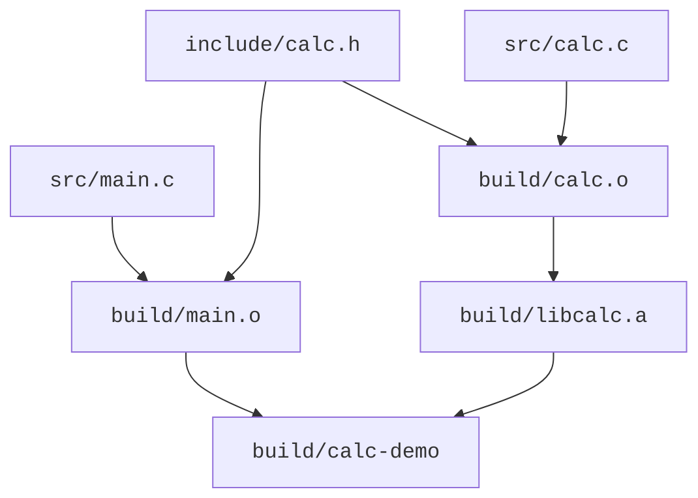

<script setup lang="ts">
import { sourceFiles } from "./example-files.ts"
</script>

# 多文件构建

每个 `.c` 文件可以分别编译成目标文件，再通过链接组成程序。头文件提供共享声明，静态库组织目标文件，构建依赖则决定修改后需要重做哪些工作。

## 把接口与实现拆开

在一个新的空目录中创建以下文件树及内容：

<CodeTree title="calc-demo" :files="sourceFiles" initial-file="src/main.c">
<template #header>

<<< ./assets/calc-demo/include/calc.h{c}

</template>
<template #calc>

<<< ./assets/calc-demo/src/calc.c{c}

</template>
<template #main>

<<< ./assets/calc-demo/src/main.c{c}

</template>
</CodeTree>

- `include/calc.h` 提供公开声明。头文件保护宏使它在同一个翻译单元中被重复包含时，声明区只展开一次。
- `src/calc.c` 定义函数，并负责库内部的日志开关。
- `src/main.c` 通过声明使用计算模块。

一个源文件连同它包含的头文件等内容，经过预处理后形成一个**翻译单元（translation unit）**。本例有两个翻译单元：`main.c` 和 `calc.c` 分别经过预处理得到的整体。它们包含同一个头文件，但仍各自编译，局部宏状态也各自独立。

包含 `calc.h` 让编译器知道 `calc_add` 的名字、参数和返回类型。`calc_add` 的函数体来自 `calc.c`，需要将它生成的目标文件参与链接。编译器不会根据头文件名自动找到并编译同名 `.c`。

## 头文件搜索路径

执行以下命令，观察其报错：

```sh
mkdir -p build
gcc -std=c17 -c src/main.c -o build/main.o
```

请自行学习完成以下内容：

1. 确定报错发生在哪一阶段（预处理、编译、汇编或链接）。
2. 学习 `-I` 选项。如何修改编译命令，使它正确工作。
3. 不改编译命令，不改代码，尝试通过更改目录结构或文件位置，让编译正确工作。
4. 不改编译命令，不移动文件，尝试通过修改代码中的 `#include` 语句，让编译正确工作。
5. `#include` 语句中使用尖括号 `<...>` 与双引号 `"..."` 的区别是什么？在本例中，哪种方式更合适？

回到原来的代码，使用 `-I` 选项指定头文件搜索路径的方式，分别编译两个源文件，获得两个目标文件 `build/main.o` 和 `build/calc.o`，然后继续完成后面的学习。

## 链接多个目标文件

运行：

```sh
gcc build/main.o -o build/main
```

学习完成：

1. 这次的报错发生在哪一阶段？
2. 怎么修改命令，使其正确工作？
3. 合并上一小节的命令，用一条命令一次性编译两个源文件并链接成可执行程序。

## 归档：把目标文件组织成静态库

静态库通常是目标文件的归档，可以将多个目标文件组织在一个 `.a` 文件中。本例只把 `build/calc.o` 一个目标放入 `build/libcalc.a`，`build/main.o` 仍单独参与最终链接：

```sh
ar rcs build/libcalc.a build/calc.o
ar t build/libcalc.a
```

第二条命令列出归档成员，应看到 `calc.o`。归档步骤没有生成可执行程序；还需要将调用者的目标文件与静态库一起链接。

请自行学习完成以下内容：

1. 学习 `ar` 命令，查清 `r`、`c`、`s` 各自的作用。重复执行第一条命令时，已有成员会怎样更新？
2. 用 `build/main.o` 和 `build/libcalc.a` 链接出 `build/calc-demo`，再运行它。应打印 `2 + 3 = 5`，与直接链接两个 `.o` 的结果相同。
3. 学习 `-L` 和 `-l` 选项，用 `-Lbuild -lcalc` 替换静态库的完整路径，完成同样的链接。两个选项分别有什么用？
4. 在本例的 GNU 链接环境中，交换 `build/main.o` 和 `build/libcalc.a` 的输入顺序，观察是否还能链接成功。链接器处理静态库时，如何依据尚未解决的符号引用选取成员？
5. 修改 `src/calc.c` 后，只重新链接已有的 `libcalc.a` 能否得到新实现？还需要更新哪些产物，应按什么顺序执行？

[GNU ar 文档](https://sourceware.org/binutils/docs/binutils/ar.html)可用于查询归档操作及成员管理；[GCC 链接选项文档](https://gcc.gnu.org/onlinedocs/gcc/Link-Options.html)说明库的搜索方式与链接次序。

## 标准库

1. 示例的 `src/main.c` 中有 `#include <stdio.h>`。为什么不需要指定 `-I` 选项就能找到它？
2. `stdio.h` 提供声明后，`printf` 的定义由谁提供？为什么不需要把它的实现源码加入编译命令？

## 增量构建

比较前面三种构建方案，后续 Makefile 和 CMake 示例采用第三种：

1. 一条命令一次性编译两个源文件并链接成可执行程序。
2. 分别编译两个源文件，得到两个目标文件，再直接链接成可执行程序。
3. 分别编译两个源文件，将 `calc.o` 归档为 `libcalc.a`，再用 `main.o` 和静态库链接成可执行程序。

分析对比这三种方案：

1. 只修改 `src/calc.c` 后，三种方案分别需要执行哪些步骤？哪些已有产物可以沿用？
2. 修改公共头文件 `include/calc.h` 后，哪些目标文件需要重新编译？静态库方案还需要更新哪些产物？
3. 想通过 `-DCALC_TRACE=1` 让 `calc_add` 输出日志，这个选项必须用于哪个源文件的编译？分别编译时，能否沿用未改变编译输入的 `main.o`？采用静态库时，还需要执行哪些步骤？

<br>

**增量构建**根据已有产物和输入变化，只执行需要更新的构建步骤。

如何判断哪些文件需要重新编译？我们可以进行依赖分析。下图展示静态库方案的文件依赖，箭头从输入指向依赖它的产物：



`calc.o` 更新后，还要更新 `libcalc.a`，再重新链接程序。直接链接两个 `.o` 的方案则省去归档步骤。

头文件也是编译输入。可以让 gcc 列出用户头文件依赖：

```sh
gcc -MM -Iinclude src/main.c
```

应得到类似 `main.o: src/main.c include/calc.h` 的依赖列表。

更大的工程还有间接包含的头文件，因此只比较 `.c` 的时间戳会漏掉变化。此外，宏定义、编译选项和工具链变化都可能使旧产物失效。依赖分析正确还不够，构建系统需要有相应的更新机制。

进入下一节前，恢复文件树中的源码，按默认日志开关 `CALC_TRACE=0` 重新编译两个 `.o`、更新静态库并链接。运行 `build/calc-demo`，应只打印 `2 + 3 = 5`。
