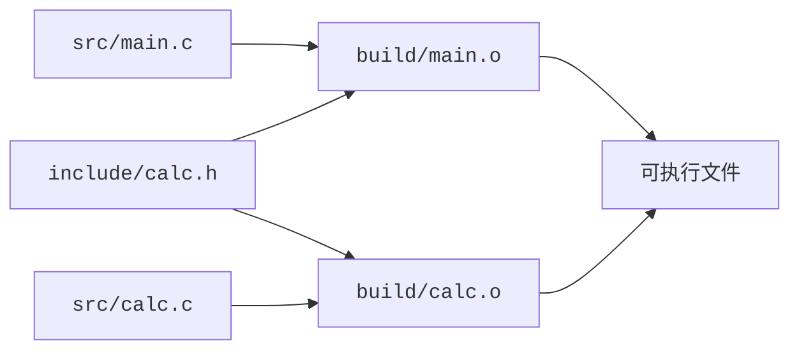

<script setup lang="ts">
import { sourceFiles } from "./example-files.ts"
</script>

# 多文件构建

每个 `.c` 文件可以分别编译成目标文件，再通过链接组成程序。头文件提供共享声明，静态库组织目标文件，构建依赖则决定修改后需要重做哪些工作。

## 把接口与实现拆开

在一个新的空目录中创建以下文件树及内容：

<CodeTree title="calc-demo" :files="sourceFiles" initial-file="src/main.c">
<template #header>

<<< ./assets/calc-demo/include/calc.h{c}

</template>
<template #calc>

<<< ./assets/calc-demo/src/calc.c{c}

</template>
<template #main>

<<< ./assets/calc-demo/src/main.c{c}

</template>
</CodeTree>

- `include/calc.h` 提供公开声明。头文件保护宏使它在同一个翻译单元中被重复包含时，声明区只展开一次。
- `src/calc.c` 定义函数，并负责库内部的日志开关。
- `src/main.c` 通过声明使用计算模块。

一个源文件连同它包含的头文件等内容，经过预处理后形成一个**翻译单元（translation unit）**。本例有两个翻译单元：`main.c` 和 `calc.c` 分别经过预处理得到的整体。它们包含同一个头文件，但仍各自编译，局部宏状态也各自独立。

包含 `calc.h` 让编译器知道 `calc_add` 的名字、参数和返回类型。`calc_add` 的函数体来自 `calc.c`，需要将它生成的目标文件参与链接。编译器不会根据头文件名自动找到并编译同名 `.c`。

## 头文件搜索路径

执行以下命令，观察其报错：

```sh
mkdir -p build
gcc -std=c17 -c src/main.c -o build/main.o
```

请自行学习完成以下内容：

1. 确定报错发生在哪一阶段（预处理、编译、汇编或链接）。
2. 学习 `-I` 选项。如何修改编译命令，使它正确工作。
3. 不改编译命令，不改代码，尝试通过更改目录结构或文件位置，让编译正确工作。
4. 不改编译命令，不移动文件，尝试通过修改代码中的 `#include` 语句，让编译正确工作。
5. `#include` 语句中使用尖括号 `<...>` 与双引号 `"..."` 的区别是什么？在本例中，哪种方式更合适？

回到原来的代码，使用 `-I` 选项指定头文件搜索路径的方式，分别编译两个源文件，获得两个目标文件 `build/main.o` 和 `build/calc.o`，然后继续完成后面的学习。

## 链接多个目标文件

运行：

```sh
gcc build/main.o -o build/main
```

学习完成：

1. 这次的报错发生在哪一阶段？
2. 怎么修改命令，使其正确工作？
3. 合并上一小节的命令，用一条命令一次性编译两个源文件并链接成可执行程序。

## 标准库

1. 示例的 `src/main.c` 中有 `#include <stdio.h>`。为什么不需要指定 `-I` 选项就能找到它？
2. 理论上头文件 `stdio.h` 也应当对应有一个源文件 `stdio.c`，为什么不需要把它加入编译命令？
3. `.a` 文件是什么？

## 增量构建

上面的学习中，我们了解到两种方案编译构建本项目：
- 一条命令一次性编译两个源文件并链接成可执行程序。
- 分别编译两个源文件，得到两个目标文件，再链接成可执行程序。

分析对比这两种方案：
1. 假如我们只修改了 `src/calc.c`，想要重新编译项目。这两种思路的差异在哪里？哪种方案更高效？
2. 假如我们修改了 `include/calc.h`，想要重新编译项目。两种方案又有什么差异？
3. 假如我们想指定 `-DCALC_TRACE=1`，让 `calc_add` 输出日志。两种方案又有什么差异？

<br>

**增量构建**根据已有产物和输入变化，只执行需要更新的构建步骤。

如何判断哪些文件需要重新编译？我们可以进行依赖分析。下图展示了本例的依赖关系，箭头从输入指向依赖它的产物：



头文件也是编译输入。可以让 gcc 列出用户头文件依赖：

```sh
gcc -MM -Iinclude src/main.c
```

应得到类似 `main.o: src/main.c include/calc.h` 的依赖列表。

更大的工程还有间接包含的头文件，因此只比较 `.c` 的时间戳会漏掉变化。此外，宏定义、编译选项和工具链变化都可能使旧产物失效。依赖分析正确还不够，构建系统需要有相应的更新机制。
