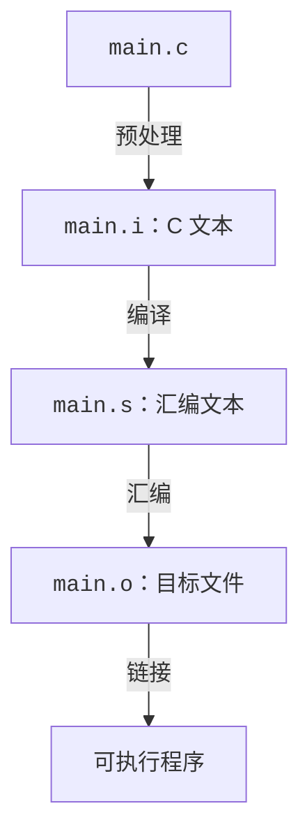

# 单文件编译与四个阶段

## 从一条编译命令开始

进入一个空目录，新建 `main.c` 写入以下代码：

<<< ./assets/single-file/main.c{c}

使用 gcc 编译并运行：

```sh
mkdir -p build
gcc -std=c17 -Wall -Wextra -Wpedantic -O0 main.c -o build/calc-demo
./build/calc-demo
```

预期输出：

```
2 + 3 = 5
```

Clang 的对应命令为：

```sh
clang -std=c17 -Wall -Wextra -Wpedantic -O0 main.c -o build/calc-clang
./build/calc-clang
```

它应产生相同的程序输出；生成的机器代码和诊断文本可以不同。

| 参数                             | 本例中的含义                           |
| -------------------------------- | -------------------------------------- |
| `main.c`                         | 输入源文件                             |
| `-o build/calc-demo`             | 指定最终输出文件路径；父目录需要先存在 |
| `-std=c17`                       | 选择 C17 语言模式                      |
| `-Wall`, `-Wextra`, `-Wpedantic` | 开启几组有助于发现问题及扩展用法的诊断 |
| `-O0`                            | 使用便于初步观察代码对应关系的优化等级 |

接下来我们来详细解释。

## 宏定义、警告与优化

### `-D`：向预处理阶段传入宏

源码用 `#ifndef` 为 `CALC_TRACE` 提供默认值 `0`。命令行定义同名宏后，这个默认定义就会被跳过：

```sh
gcc -std=c17 -DCALC_TRACE=1 main.c -o build/calc-trace
./build/calc-trace
```

预期输出：

```
[calc] add(2, 3)
2 + 3 = 5
```

`-DNAME=value` 提供宏的替换内容；`-DNAME` 等价于定义为 `1`。它影响本次命令中要预处理的源文件。

### `-W...`：请求诊断

`-Wall` 开启一组常用警告，`-Wextra` 补充其他警告，`-Wpedantic` 根据所选标准报告部分不符合标准的用法。`-Wall` 的名字不表示启用了所有警告；无警告也不能证明程序正确。

保存一个故意有未使用变量的 `unused.c`：

```c
int main(void)
{
    int unused = 3;
    return 0;
}
```

对同一份源码依次执行三组命令。每次编译后立即用 `echo $?` 查看上一条命令的退出状态：`0` 表示成功，非零表示失败。

```sh
gcc -std=c17 unused.c -o build/unused-default
echo $?

gcc -std=c17 -Wall unused.c -o build/unused-warning
echo $?

gcc -std=c17 -Wall -Werror unused.c -o build/unused-error
echo $?
```

在 GCC 13.3.0 下，结果如下；具体诊断文字可能随版本变化：

| 额外选项        | 诊断               | 退出状态 | 本次是否生成程序 |
| --------------- | ------------------ | -------- | ---------------- |
| 无              | 本例无诊断         | `0`      | 是               |
| `-Wall`         | 未使用变量的警告   | `0`      | 是               |
| `-Wall -Werror` | 同一问题被视为错误 | 非零     | 否               |

后两组的诊断分别类似：

```
warning: unused variable 'unused' [-Wunused-variable]
error: unused variable 'unused' [-Werror=unused-variable]
```

第一组没有额外开启警告，不代表 GCC 关闭了所有诊断；只是本例的问题没有被默认报告。`-Wall` 使它被报告为警告，编译仍能成功。

`-Werror` 将产生的警告视为错误，可用于让自动构建在出现警告时失败。

### `-O...`：选择优化等级

优化会改变生成代码、编译耗时和调试时的观察结果。`-O0` 适合先观察源代码与汇编的大致关系；`-O2` 开启更多优化，可能内联函数、折叠常量或消除无用代码。

不过，`-O0` 也包含生成代码所必需的转换，`-O2` 则不保证每个程序都更快或更小。

各等级具体控制什么，可查 [GCC 优化选项](https://gcc.gnu.org/onlinedocs/gcc/Optimize-Options.html)。

## 四个阶段及产物

本例用下面的模型观察构建：



这里“编译”专指将预处理后的 C 程序转换为汇编文本的阶段；日常口语中的“编译项目”也可能指整段构建过程。

### 1. 预处理：得到 `.i`

```sh
gcc -std=c17 -DCALC_TRACE=0 -E main.c -o build/main.i
```

预处理处理 `#include`、宏替换和条件编译等指令。`stdio.h` 的内容会出现在结果中，因此 `.i` 往往比源码长得多。与本例有关的文本节选大致如下：

```c
/* 省略系统头文件展开内容和来源行标记 */
int calc_add(int a, int b)
{
    return a + b;
}

int main(void)
{
    printf("2 + 3 = %d\n", calc_add(2, 3));
    return 0;
}
```

日志语句已被排除。把命令改为 `-DCALC_TRACE=1` 并写入另一个 `.i`，应能在 `calc_add` 中找到日志调用。`#include <stdio.h>` 带入的是声明等头文件内容，`printf` 的库实现由后续链接处理。

### 2. 编译：得到 `.s`

```sh
gcc -std=c17 -Wall -Wextra -Wpedantic -O0 -S build/main.i -o build/main.s
```

编译器进行语法、类型等检查并生成代码。本例的输出是可以阅读的汇编文本；x86-64 Linux 上可能看到类似节选：

```asm
    .globl calc_add
calc_add:
    # 省略函数入口和取参数的指令
    addl %edx, %eax
    # 省略函数退出前的指令
    ret
```

此处只需辨认函数标签和机器指令的文本形式。具体寄存器、指令和辅助信息随环境变化。

再直接从源码比较两种优化等级：

```sh
gcc -std=c17 -O0 -S main.c -o build/main-o0.s
gcc -std=c17 -O2 -S main.c -o build/main-o2.s
diff -u build/main-o0.s build/main-o2.s
```

重点查看 `main` 中是否仍调用 `calc_add`，以及是否直接使用已计算的常量 `5`。以实际产物为准；`diff` 返回非零在这里通常表示文件存在差异。

### 3. 汇编：得到 `.o`

```sh
gcc -c build/main.s -o build/main.o
file build/main.o
nm build/main.o
objdump -dr build/main.o
```

`.o` 是二进制目标文件，包含机器代码、数据、符号和重定位信息等。它通常还不能直接执行。`file` 的结果应包含 `relocatable`，表示可重定位目标文件。

`nm` 列出符号，忽略地址后可找到：

```
T calc_add
T main
U printf
```

`T` 表示本目标文件的代码区定义了该符号；`U` 表示该符号还需要外部定义。本例已经包含 `printf` 的声明，也能生成调用代码，但尚未完成与库的链接。

`objdump -dr` 把机器代码反汇编并显示重定位信息。某条加法指令可能显示为：

```
10:  01 d0    add %edx,%eax
```

地址和字节值仅作示意。这里看到的是工具对二进制文件的解释，`.o` 自身并不是这些文本。[`nm` 文档](https://sourceware.org/binutils/docs/binutils/nm.html)用于查询符号类别，[`objdump` 文档](https://sourceware.org/binutils/docs/binutils/objdump.html)用于查询反汇编和重定位选项。

### 4. 链接：得到可执行程序

```sh
gcc build/main.o -o build/calc-staged
file build/calc-staged
./build/calc-staged
```

`gcc` 驱动链接器，将目标文件与所需的启动支持和库组合起来，处理符号引用及地址安排。这里通过默认的 C 库链接满足 `printf` 等引用。

`file` 的结果应包含 `executable`，运行应打印 `2 + 3 = 5`。常见 Linux 环境生成的是动态链接程序；运行时加载器还会参与加载所需共享库。链接完成不表示所有库实现都已复制进可执行文件。
